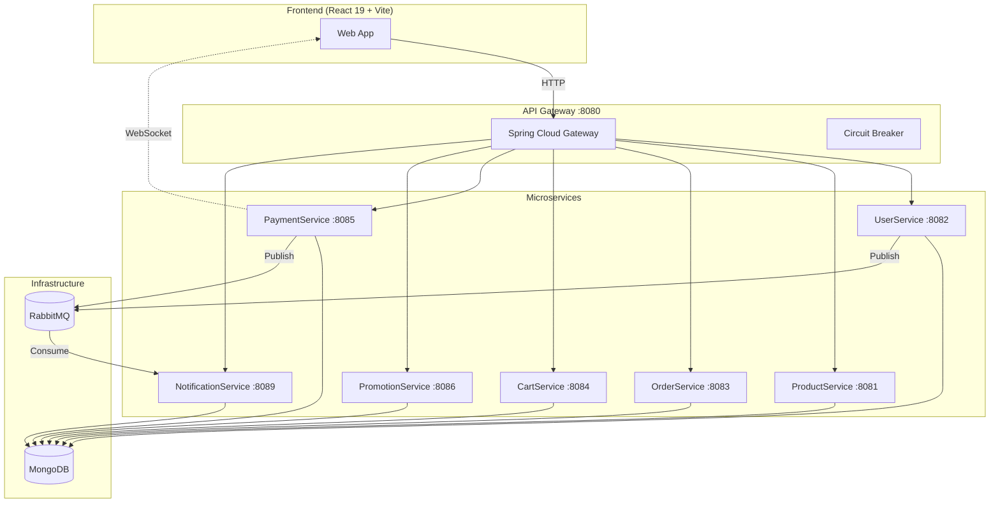

<div align="center">

# 🏬 Household Appliance E-Commerce

**Microservices-Based E-Commerce Platform for Home Appliances**

[](https://openjdk.org/)
[](https://spring.io/projects/spring-boot)
[](https://www.mongodb.com/)
[](https://www.rabbitmq.com/)
[](https://react.dev/)
[](https://docs.docker.com/compose/)

A full-stack e-commerce platform built with **microservices architecture** — 7 independent services communicating via REST & RabbitMQ, containerized with Docker Compose, and deployed on Render.

[Live Demo](https://tht-giadungthongminh.vercel.app/) · [API Gateway](https://websitebandogiadung-dqzs.onrender.com)

</div>

---

## ✨ Key Features

| Feature | Description |
|---------|-------------|
| 🛒 **Product Catalog** | Browse, search, and filter home appliances with pagination and category management |
| 🛍️ **Shopping Cart** | Real-time cart with automatic price sync from Product Service |
| 📦 **Order Management** | Full order lifecycle with stock validation and delivery tracking |
| 💳 **Dual Payment** | Cash on Delivery (COD) + **SEPay QR code** bank transfer with real-time WebSocket status |
| 🎫 **Promotions** | Discount codes by product category with date-based activation |
| 🔔 **Notifications** | Event-driven notifications via RabbitMQ + professional HTML email templates |
| 🔐 **Authentication** | JWT-based auth with email verification (6-digit OTP), password reset, and role-based access |
| ⭐ **Product Reviews** | User ratings and comments with average score calculation |
| 📊 **Admin Dashboard** | Order analytics, revenue charts, and inventory management |

---

## 🏗 System Architecture



---

## 🔗 Service Communication

| From | To | Method | Purpose |
|------|----|--------|---------|
| OrderService | ProductService | REST | Validate stock & fetch prices |
| OrderService | PaymentService | REST | Initiate payment after order |
| CartService | ProductService | REST | Sync product prices |
| ProductService | UserService | REST | Validate reviewer identity |
| UserService | NotificationService | RabbitMQ | Welcome notification on signup |
| PaymentService | NotificationService | RabbitMQ | Payment confirmation |
| PaymentService | Frontend | WebSocket | Real-time QR payment status |

---

## 🛠 Tech Stack

### Backend (Per Service)
| Category | Technologies |
|----------|-------------|
| **Framework** | Java 21, Spring Boot 3.2.2, Spring Cloud 2023.0.1 |
| **Database** | MongoDB 6 (per-service database pattern) |
| **Messaging** | RabbitMQ 3 (async event-driven notifications) |
| **Gateway** | Spring Cloud Gateway, Resilience4j Circuit Breaker |
| **Security** | Spring Security, JWT (JJWT 0.11.5), BCrypt |
| **Mapping** | MapStruct 1.5.5 |
| **Email** | Spring Mail (Gmail SMTP) |
| **Monitoring** | Spring Actuator, Micrometer Prometheus |
| **Testing** | JUnit 5, Testcontainers (MongoDB, RabbitMQ) |

### Frontend
| Category | Technologies |
|----------|-------------|
| **Framework** | React 19, Vite 6, JavaScript |
| **Styling** | TailwindCSS 4, Framer Motion |
| **HTTP** | Axios |
| **Real-time** | SockJS + STOMP (WebSocket) |
| **Charts** | Chart.js (react-chartjs-2) |
| **UI** | Lucide React, Font Awesome, Swiper |
| **PDF** | jsPDF + jsPDF-AutoTable (Invoice generation) |
| **Deploy** | Vercel |

---

## 📂 Project Structure

```
WebsiteBanDoGiaDung/
├── backend/
│   ├── api-gateway/          # Spring Cloud Gateway (routing, CORS, circuit breaker)
│   ├── UserService/          # Authentication, JWT, email verification
│   ├── ProductService/       # Product CRUD, categories, reviews, search
│   ├── OrderService/         # Order lifecycle, stock management
│   ├── CartService/          # Shopping cart operations
│   ├── PaymentService/       # COD + SEPay QR payments, WebSocket
│   ├── PromotionService/     # Discount codes management
│   ├── NotificationService/  # RabbitMQ consumer, email sender
│   └── docker-compose.yml    # Full stack orchestration
├── frontend/
│   ├── src/                  # React components, pages, hooks
│   ├── tailwind.config.js    # TailwindCSS configuration
│   └── vercel.json           # Vercel deployment config
└── README.md
```

---

## ⚡ Quick Start

### Prerequisites
- **Java 21** + Gradle
- **Node.js 18+** + npm
- **Docker** + Docker Compose
- **MongoDB** (or use Docker)
- **RabbitMQ** (or use Docker)

### 1. Start Infrastructure (Docker)

```bash
cd backend
docker-compose up -d mongo rabbitmq
```

### 2. Start Backend Services

```bash
# Start each service (in separate terminals)
cd backend/api-gateway && ./gradlew bootRun
cd backend/UserService && ./gradlew bootRun
cd backend/ProductService && ./gradlew bootRun
cd backend/OrderService && ./gradlew bootRun
cd backend/CartService && ./gradlew bootRun
cd backend/PaymentService && ./gradlew bootRun
cd backend/PromotionService && ./gradlew bootRun
cd backend/NotificationService && ./gradlew bootRun
```

**Or start everything with Docker Compose:**

```bash
cd backend
docker-compose up --build
```

### 3. Start Frontend

```bash
cd frontend
npm install
npm run dev
```

> Frontend runs at `http://localhost:5174` · API Gateway at `http://localhost:8080`

---

## 🔌 API Endpoints

| Service | Base Path | Key Endpoints |
|---------|-----------|--------------|
| **User** | `/api/users` | `POST /login`, `POST /`, `POST /verify`, `POST /forgot-password` |
| **Product** | `/api/products` | `GET /`, `POST /`, `GET /search`, `POST /{id}/reviews` |
| **Order** | `/api/orders` | `POST /`, `GET /?userId=`, `PUT /{id}/delivery-status` |
| **Cart** | `/api/carts` | `POST /items`, `PUT /items/{id}`, `DELETE /items` |
| **Payment** | `/api/payments` | `POST /`, `POST /sepay`, `POST /webhook/sepay` |
| **Promotion** | `/api/promotions` | `POST /`, `GET /active`, `GET /category/{id}` |
| **Notification** | `/api/notifications` | `GET /{userId}`, `PUT /{id}/read` |

---

## 👥 Contributors

**Team 14 — IUH Software Engineering**

| Name           | Role                                             |
|----------------|--------------------------------------------------|
| Trần Công Tính | Backend Architecture & DevOps |
| Trần Ngọc Hưng | Frontend Development |
| Hồ Vĩnh Thái | Backend Services |

---

## 📄 License

This project was developed as a university coursework project at the Industrial University of Ho Chi Minh City (IUH).

---

<div align="center">

**Built with ❤️ at IUH — 2025**

</div>
